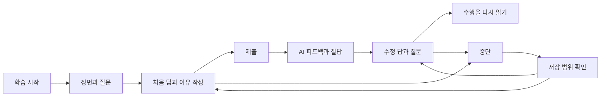

# 개인 영어 학습 앱 디자인 제안

2026-10-26 강PD가 앱 디자인을 처음부터 다시 하도록 지시했다. 이어 이미지와 터미널 같은 AI 대화를 요구하고,
첫 시안이 웹페이지처럼 보인다고 지적했다. 이 문서는 그 지시를 반영한 학습 작업 공간의 디자인이다.
새 탐색 구조·색·서체·배치의 적합성은 아직 확인하지 않았다. 요구사항은 `docs/learning-service.md`,
설계 판단은 `knowledge/domain/web-app-ux-design.md`, 이번 완료 조건은 `docs/tasks/ux-redesign.md`가 소유한다.

## 경험의 중심

처음 열면 현재 장면과 답안·대화를 바로 다룬다. 큰 소개 문구와 자료 목록을 먼저 읽고 진입하는 구조를 걷어 낸다.
장면을 읽고 답과 이유를 제출한 뒤 같은 자리에서 AI에게 묻고, 설명을 바탕으로 답을 고치고 다시 질문한다.
자료와 내 기록은 활성 학습을 떠나지 않고 열어 보는 보조 영역이다.

지금 답하는 문제의 맥락과 내 입력을 중심에 두고, 학습 자료와 지난 기록은 그 일을 돕는 위치에 둔다.
화면의 목표는 더 많은 정보를 늘어놓는 것이 아니라, 지금 할 판단과 그 결과를 알아볼 수 있게 하는 것이다.
이것은 UX 모델 관계 1·2·4·5·9·11·12를 적용한 설계 가설이다. 소개 중심 첫 시안은 보관하고 실제 Next.js 화면으로 옮긴다.

## 정보구조와 화면

| 영역 | 사용자가 하려는 일 | 처음 보일 것 | 빈 상태 |
| --- | --- | --- | --- |
| 학습 | 문제를 시작하거나 중단한 곳에서 계속한다 | 자료·현재 단계·시작 또는 이어 하기 | 처음 연습할 자료. 가짜 진행률을 넣지 않는다 |
| 기록 | 처음 답과 이후 변화를 다시 읽는다 | 장면별 처음 제출·이유·수정·질문 | 아직 제출한 답이 없다고 알린다 |
| 자료 찾기 | 감각 사전과 책 장면을 찾아본다 | 현재 준비된 표제어와 설명 | 아직 준비하지 않은 자료를 실제 자료처럼 열지 않는다 |

독립 문장 해설은 보조 도구로 이어 갈 수 있다. 문제 안의 질문은 해당 장면·수행과 연결해야 하며,
일반 대화창 하나로 학습·자료·기록을 모두 대신하지 않는다. 운영 URL과 기존 공개 페이지의 연결 방식은
`docs/tasks/learning-workspace.md`에서 정한다. 기존 공개 문제·감각 페이지와 단문 해설 주소는 유지한다.

## 학습 화면의 관계

PC에서는 간결한 앱 도구막대 안에 장면·문제와 답안·AI 대화를 인접하게 둔다. 화면 높이 안에서 각 영역을
읽고 조작하며, 대화가 길어져도 현재 문제로 돌아올 수 있다. 모바일은 장면·답안·대화의 전환을 제공하고
전환 중에도 입력과 대화가 남는다. 고정 입력기가 키보드 초점과 답안을 가리지 않게 확인한다.

| 의미 역할 | 디자인에서 드러낼 관계 | 동작 조건 |
| --- | --- | --- |
| 장면·자료 | 출처·화자·상황을 묶고 본문을 읽기 편하게 둔다 | 답의 단서를 임의로 덧붙이지 않는다 |
| 질문 | 지금 판단할 한 가지를 뚜렷하게 보인다 | 관련 장면을 함께 찾을 수 있다 |
| 내 답·이유 | 직접 조작하는 입력 영역으로 구분한다 | 선택과 제출을 분리한다 |
| 주 행동 | 이번 단계가 낼 결과를 이름으로 알린다 | 무관한 여러 강조 버튼을 경쟁시키지 않는다 |
| 피드백 | 출처와 내 수행을 구분해 보여 준다 | 제출 후 공개한다. 기존 해설을 AI의 새 판단처럼 표시하지 않는다 |
| 수정·질문 | 처음 제출과 구분하되 같은 장면에 연결한다 | 최초 답을 덮어쓰지 않는다 |
| 저장 상태 | 눈에 띄되 읽기를 방해하지 않는 곳에 글로 표시한다 | 실제 성공한 저장 위치·범위를 넘게 말하지 않는다 |

이 표는 UX 모델 규칙 2~7·9·11·12를 적용한 것이다. 첫 구현은 기존 have 문항의 답 선택·이유 제출과
제출 뒤의 AI 다중 대화를 연결한다. 학습 내용의 오답을 입력 형식 오류로 차단하지 않는다.

## 시각 체계의 첫 방향

읽고 쓰는 노트를 첫 방향으로 삼는다. 따뜻한 밝은 바탕과 짙은 글자, 제한된 강조색을 사용하고,
자료 본문의 읽기와 앱 조작을 타이포·간격으로 구분한다. 색 선택이 강PD에게 맞는다는 뜻은 아니다.
현재 시각 값은 실제 앱의 `app/workspace.css`가 소유한다. `design/prototype/index.html`은 이전 소개 중심 제안이다.
강PD가 색·서체·배치의 적합성을 확인한 것으로 취급하지 않는다.

| 축 | 첫 시안에서 확인할 것 | 피할 문제 |
| --- | --- | --- |
| 글자 | 한국어 안내와 영어 장면의 읽기 순서·위계 | 장식 제목이 장면·입력보다 강해지는 것 |
| 폭·간격 | 장면과 입력이 함께 읽히고 긴 해설도 이어지는가 | 모든 문단을 카드에 가두거나 고정 높이로 자르는 것 |
| 색·형태 | 주 행동·피드백·저장 실패가 글과 함께 구별되는가 | 초록·빨강만으로 정오답을 알리는 것 |
| 반복 요소 | 같은 탐색·저장·제출이 같은 뜻으로 보이는가 | 같은 모양이 화면마다 다른 결과를 내는 것 |
| 움직임 | 상태 변화가 읽기 위치를 흔들지 않는가 | 자동 스크롤·과한 전환·초점 탈취 |

모바일에서는 내비게이션을 재배치하고 장면과 답안을 한 흐름으로 둔다. 주요 조작의 목표 크기는 시안에서
44 CSS px 이상을 목표로 한다. 이는 이 시안의 선택이며 WCAG 2.2 AA의 예외가 있는 24 CSS px 최소 기준과 다르다.
320 CSS px 리플로, 키보드 조작, 보이는 초점과 고정 내비게이션의 가림 여부를 실제 브라우저에서 확인한다.
일부 조건을 점검했다고 전체 WCAG 준수로 보고하지 않는다.

## 상태·실패·중단

| 상황 | 알려 줄 사실 | 남길 행동 |
| --- | --- | --- |
| 작성 중 | 아직 제출하지 않은 답이다 | 계속 쓰거나 나갔다가 돌아온다 |
| 처음 제출 후 | 무엇을 제출했고 어떤 출처의 피드백을 읽는지 | 피드백 확인·스스로 수정·질문 |
| 저장 성공 | 어느 범위에 보관됐는지 | 같은 범위에서 다시 연다 |
| 저장 실패 | 현재 입력은 남아 있지만 보관되지 않았다는 사실 | 입력 유지·저장 재시도 |
| 외부 응답 실패 | 답 저장과 해설 요청 중 어디서 실패했는지 | 저장된 수행은 유지하고 필요한 호출만 재시도 |
| 재개 | 자료·문제·단계·작성 중 입력과 제출한 값 | 마지막 맥락에서 계속한다 |

`/api/learn-chat/`가 실제 AI 응답을 요청하며, 최초 제출 전에는 출처를 밝힌 준비 안내를 제공한다.
서버는 정본 장면과 제출된 답·이유·수정·이전 대화를 함께 읽고, 아직 보내지 않은 초안을 자동 전송하지 않는다.
임의의 숙달 점수·복습일·학습 완료를 넣지 않는다.

## 이미지와 감각 도식

장면 영역에는 복도 문에서 졸린 아이가 나오는 상황을 재구성한 그림을 둔다. 원서의 실제 삽화나 역사 자료로
표시하지 않고 학습용 재구성이라고 밝힌다. 감각 설명에는 주어의 영역과 그 안에 놓인 대상을 표현하는 도식을 쓴다.
이 그림과 본문의 역할을 구별하고 대체 설명을 함께 둔다. 정답 문장이나 선택지 종류를 그림에 적지 않는다.
그림이 로딩되지 않아도 장면 본문·질문·답안·대화는 사용할 수 있다.

## 실제 구현과 남은 경계

현재 Next.js 기본 화면에 학습 작업 공간을 연결한다. 실제 AI 대화의 요청·응답과 브라우저 임시 저장이 있는 첫 구현이며,
개인 서버 저장·인증·다른 기기 동기화는 남아 있다. 브라우저 데이터 삭제나 저장 차단에서는 복원할 수 없다.
해당 have 문제는 기존 자료를 연결한 첫 과업이며 다음 로드맵 유닛을 새로 정한 것이 아니다.
현재 API는 제출 전의 생성형 힌트 대화까지 제공하지 않는다. 준비 안내와 제출 뒤 실제 AI 응답을 화면에서 구분한다.
요청·응답 크기, 대화 길이, 재시도·비용과 공개 순서의 한계는 작업 계약에 있다.

## 검토와 실제 앱으로 옮기는 조건

Lighthouse의 약속→수용 조건→실행 근거 연결을 사용하되, 이 앱에는 계약 한 문서 안에서 조건과 근거를 잇는다.
상세 원문 추적과 발견한 불일치는 `docs/research/lighthouse-contract-engineering.md`에 있다.
브라우저 임시 복원과 개인 서버 저장·인증의 검증 범위를 나누며, 준비된 데이터의 화면 검사로 실제 저장·복원 경로를 대신하지 않는다.

강PD가 시안을 사용할 때는 버튼 이름을 알려 주기보다 '문제를 풀고 해설을 확인해 보세요',
'지난번 쓰던 답에서 계속해 보세요', '처음 답과 고친 답을 다시 읽어 보세요'처럼 목표를 제시한다.
실제 관찰 전에는 이해하기 쉽다거나 편리해졌다고 결론 내리지 않는다.

이번 구현에서는 Next.js 경로·콘텐츠 계약·클라이언트 상태·대화 API와 수용 검사를 연결한다.
브라우저 임시 보관을 장기 개인 기록의 정본으로 확정하지 않는다. 실제 사용 뒤 선택할 시각 방향과
개인 서버 저장·인증·다른 기기 복원은 작업 이슈 #4에서 이어 간다.
