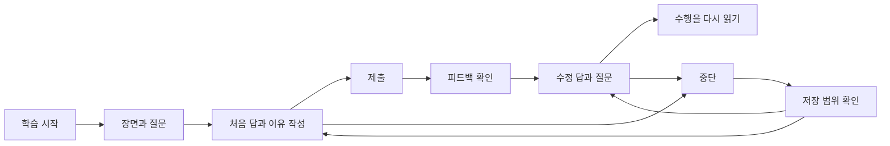

# 개인 영어 학습 앱 디자인 제안

2026-10-26 강PD가 앱 디자인을 처음부터 다시 하도록 지시했다. 이 문서는 그 범위 안에서 만든 첫 제안이다.
새 탐색 구조·색·서체·배치의 적합성은 아직 확인하지 않았다. 요구사항은 `docs/learning-service.md`,
설계 판단은 `knowledge/domain/web-app-ux-design.md`, 이번 완료 조건은 `docs/tasks/ux-redesign.md`가 소유한다.

## 경험의 중심

장면을 읽고, 먼저 답하고, 피드백을 바탕으로 내 답을 다시 쓰는 작업 공간으로 만든다.
처음 화면은 학습의 시작점이나 중단한 위치를 보여 준다. 표제어·연습·독립 해설기의 공개 페이지 분류를
새 앱의 탐색 구조로 그대로 쓰지 않는다. 기존 설명·장면·문제는 활용하며 현재 스타일을 보존한다는 전제는 두지 않는다.

지금 답하는 문제의 맥락과 내 입력을 중심에 두고, 학습 자료와 지난 기록은 그 일을 돕는 위치에 둔다.
화면의 목표는 더 많은 정보를 늘어놓는 것이 아니라, 지금 할 판단과 그 결과를 알아볼 수 있게 하는 것이다.
이것은 UX 모델 관계 1·2·4·5·9를 적용한 설계 가설이다.

## 정보구조와 화면

| 영역 | 사용자가 하려는 일 | 처음 보일 것 | 빈 상태 |
| --- | --- | --- | --- |
| 학습 | 문제를 시작하거나 중단한 곳에서 계속한다 | 자료·현재 단계·시작 또는 이어 하기 | 처음 연습할 자료. 가짜 진행률을 넣지 않는다 |
| 기록 | 처음 답과 이후 변화를 다시 읽는다 | 장면별 처음 제출·이유·수정·질문 | 아직 제출한 답이 없다고 알린다 |
| 자료 찾기 | 감각 사전과 책 장면을 찾아본다 | 현재 준비된 표제어와 설명 | 아직 준비하지 않은 자료를 실제 자료처럼 열지 않는다 |

독립 문장 해설은 보조 도구로 이어 갈 수 있다. 문제 안의 질문은 해당 장면·수행과 연결해야 하며,
일반 대화창 하나로 학습·자료·기록을 모두 대신하지 않는다. 운영 URL과 기존 공개 페이지의 연결 방식은
실제 Next.js 구현 계약에서 정한다. 새 화면을 만들었다는 이유로 기존 외부 링크를 끊지 않는다.

## 학습 화면의 관계

PC에서는 자료와 답안 영역을 인접하게 두고, 모바일에서는 자료→질문→답안→주 행동 순서로 읽게 한다.
장면·질문을 오래 고정해 화면을 점유하기보다, 필요할 때 다시 읽을 수 있게 하면서 입력과 위치를 보존한다.
제출 뒤 피드백이 나타나도 입력 중인 수정이나 질문을 가리지 않는다.



| 의미 역할 | 디자인에서 드러낼 관계 | 동작 조건 |
| --- | --- | --- |
| 장면·자료 | 출처·화자·상황을 묶고 본문을 읽기 편하게 둔다 | 답의 단서를 임의로 덧붙이지 않는다 |
| 질문 | 지금 판단할 한 가지를 뚜렷하게 보인다 | 관련 장면을 함께 찾을 수 있다 |
| 내 답·이유 | 직접 조작하는 입력 영역으로 구분한다 | 선택과 제출을 분리한다 |
| 주 행동 | 이번 단계가 낼 결과를 이름으로 알린다 | 무관한 여러 강조 버튼을 경쟁시키지 않는다 |
| 피드백 | 출처와 내 수행을 구분해 보여 준다 | 제출 후 공개한다. 기존 해설을 AI의 새 판단처럼 표시하지 않는다 |
| 수정·질문 | 처음 제출과 구분하되 같은 장면에 연결한다 | 최초 답을 덮어쓰지 않는다 |
| 저장 상태 | 눈에 띄되 읽기를 방해하지 않는 곳에 글로 표시한다 | 실제 성공한 저장 위치·범위를 넘게 말하지 않는다 |

이 표는 UX 모델 규칙 2~7·9를 이 화면에 적용한 것이다. '아직 모르겠습니다' 같은 별도 제출 행동의
운영 도입 여부는 실제 학습 계약에서 정한다. 이번 시안은 기존 문항의 답 선택과 이유 제출을 구현한다.

## 시각 체계의 첫 방향

읽고 쓰는 노트를 첫 방향으로 삼는다. 따뜻한 밝은 바탕과 짙은 글자, 제한된 강조색을 사용하고,
자료 본문의 읽기와 앱 조작을 타이포·간격으로 구분한다. 색 선택이 강PD에게 맞는다는 뜻은 아니다.
시각 값의 정본은 `design/prototype/index.html`의 CSS다. 승인한 제품 디자인 토큰으로 확정하지 않는다.

| 축 | 첫 시안에서 확인할 것 | 피할 문제 |
| --- | --- | --- |
| 글자 | 한국어 안내와 영어 장면의 읽기 순서·위계 | 장식 제목이 장면·입력보다 강해지는 것 |
| 폭·간격 | 장면과 입력이 함께 읽히고 긴 해설도 이어지는가 | 모든 문단을 카드에 가두거나 고정 높이로 자르는 것 |
| 색·형태 | 주 행동·피드백·저장 실패가 글과 함께 구별되는가 | 초록·빨강만으로 정오답을 알리는 것 |
| 반복 요소 | 같은 탐색·저장·제출이 같은 뜻으로 보이는가 | 같은 모양이 화면마다 다른 결과를 내는 것 |
| 움직임 | 상태 변화가 읽기 위치를 흔들지 않는가 | 자동 스크롤·과한 전환·초점 탈취 |

모바일에서는 내비게이션을 재배치하고 장면과 답안을 한 흐름으로 둔다. 주요 조작의 목표 크기는 시안에서
44 CSS px 이상을 목표로 한다. 이는 이 시안의 선택이며 WCAG 2.2 AA의 예외가 있는 24 CSS px 최소 기준과 다르다.
320 CSS px 리플로, 키보드 조작, 보이는 초점과 고정 내비게이션의 가림 여부를 실제 브라우저에서 확인한다.
일부 조건을 점검했다고 전체 WCAG 준수로 보고하지 않는다.

## 상태·실패·중단

| 상황 | 알려 줄 사실 | 남길 행동 |
| --- | --- | --- |
| 작성 중 | 아직 제출하지 않은 답이다 | 계속 쓰거나 나갔다가 돌아온다 |
| 처음 제출 후 | 무엇을 제출했고 어떤 출처의 피드백을 읽는지 | 피드백 확인·스스로 수정·질문 |
| 저장 성공 | 어느 범위에 보관됐는지 | 같은 범위에서 다시 연다 |
| 저장 실패 | 현재 입력은 남아 있지만 보관되지 않았다는 사실 | 입력 유지·저장 재시도 |
| 외부 응답 실패 | 답 저장과 해설 요청 중 어디서 실패했는지 | 저장된 수행은 유지하고 필요한 호출만 재시도 |
| 재개 | 자료·문제·단계·작성 중 입력과 제출한 값 | 마지막 맥락에서 계속한다 |

외부 응답 실패 행은 운영 구현의 설계 조건이며 이번 시안에 실제 AI 호출은 없다. 시안에서 만든 질문은
직접 입력한 문장으로만 남기고 AI의 답을 지어내지 않는다. 임의의 숙달 점수·복습일·학습 완료를 넣지 않는다.

## 조작 가능한 시안과 경계

`design/prototype/index.html`은 기존 타이타닉 have 연습의 한 문항으로 디자인을 살펴보는 별도 시안이다.
이 자료를 다음 로드맵 유닛이라고 표시하지 않는다. 디자인 미리보기이며 같은 브라우저의 localStorage에만
임시 보관한다고 알린다. 서버 저장·인증·다른 기기 동기화·AI 피드백 생성은 구현하지 않는다.
브라우저 데이터 삭제나 저장 차단에서는 복원할 수 없다. 이 상태를 실제 개인 학습 서비스의 완성으로 보고하지 않는다.

저장소 루트에서 다음 명령으로 열 수 있다. 운영 Next.js 앱의 빌드·배포와는 별개다.

```sh
python3 -m http.server 8746 --bind 127.0.0.1 --directory design/prototype
```

브라우저에서 `http://127.0.0.1:8746/`을 연다. 동작 확인을 위한 실패 재현은 별도 접힌 패널에서만 제공한다.

## 검토와 실제 앱으로 옮기는 조건

Lighthouse의 약속→수용 조건→실행 근거 연결을 사용하되, 이 앱에는 계약 한 문서 안에서 조건과 근거를 잇는다.
상세 원문 추적과 발견한 불일치는 `docs/research/lighthouse-contract-engineering.md`에 있다.
프로토타입과 운영 저장·인증의 검증 범위를 나누며, 준비된 데이터의 화면 검사로 실제 저장·복원 경로를 대신하지 않는다.

강PD가 시안을 사용할 때는 버튼 이름을 알려 주기보다 '문제를 풀고 해설을 확인해 보세요',
'지난번 쓰던 답에서 계속해 보세요', '처음 답과 고친 답을 다시 읽어 보세요'처럼 목표를 제시한다.
실제 관찰 전에는 이해하기 쉽다거나 편리해졌다고 결론 내리지 않는다.

운영 앱으로 옮길 때는 Next.js 경로·콘텐츠 계약·클라이언트 상태·서버 저장·인증과 수용 검사를 함께 연결한다.
시안의 DOM·localStorage를 그대로 운영 구조로 확정하지 않는다. 실제 사용 뒤 선택할 시각 방향과 남은
개인 학습 기능은 작업 이슈 #4에서 이어 간다.
