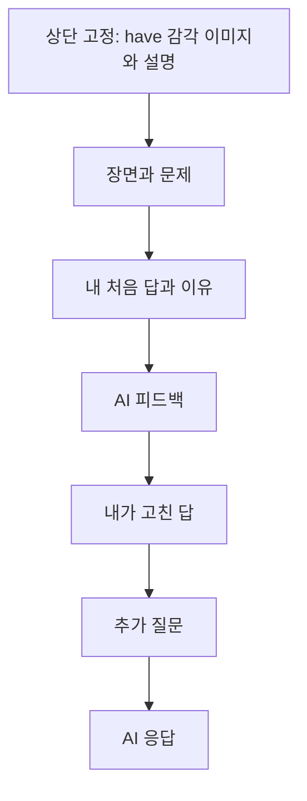

# 개인 영어 학습의 대화 화면

2026-10-26 강PD는 이미지의 대상이 책 장면이 아니라 have 같은 표현의 감각이라고 바로잡았다.
학습은 탭을 넘기기보다 채팅처럼 콘텐츠가 쌓이는 방식으로 진행하고, 감각 자료는 상단에 두도록 정했다.
이 문서는 승인한 방향을 이번 구현에 적용할 설계다. 실제 구현 상태·수용 근거는 `docs/tasks/quiz-artifacts.md`,
제품 요구는 `docs/learning-service.md`, 설계 판단은 `knowledge/domain/web-app-ux-design.md`가 소유한다.

## 화면의 중심

상단에 표현의 감각 이미지와 짧은 설명을 고정하고, 아래에는 하나의 학습 대화를 둔다.
문제를 읽고 답과 이유를 제출하면 그 답이 대화에 남고 AI의 피드백이 이어진다.
퀴즈는 장면·문제·입력·제출 상태를 가진 독립 아티팩트다. 다음 퀴즈도 이전 카드를 남기고 대화 아래에 추가한다.
카드마다 최초 답·수정·질문 초안을 보존하고, 관련 질답의 대상을 표시한다. 실제 사건은 일어난 순서대로 쌓인다.
앞의 감각·장면·답·설명은 같은 흐름을 위로 스크롤해 다시 읽는다. 학습 단계별 탭은 사용하지 않는다.

## 상단 감각 자료

| 요소 | 역할 | 표현 |
| --- | --- | --- |
| 표현 | 지금 이해할 감각의 기준 | have |
| 핵심 설명 | 영역 관계를 짧게 드러낸다 | 내 영역 안에 놓여 있다 |
| 감각 이미지 | 주어와 그 주어의 영역 안에 놓인 대상을 함께 본다 | 사람을 둘러싼 영역 안의 물건·몸·마음·시간·할 일 |
| 근접 본문 | 영역을 물건의 소유나 물리 공간으로 좁히지 않는다 | 물건뿐 아니라 몸, 마음, 시간, 할 일, 지난 일도 내 영역이 됩니다 |
| 펼침 | 자세한 그림을 필요할 때 읽는다 | 감각 자료 펼치기·접기 |

정본은 study-and-learn의 감각 사전 have 줄과 `content/scene-sense/have.md`다. 이미지의 그림체·도상·배치는
정본의 관계를 옮긴 설계 선택이며 학습 효과를 입증한 자료가 아니다. 획득 화살표·소유권 표식·책 장면 삽화를
주된 이미지로 쓰지 않는다. 현재 그림은 `public/assets/learning/have-sense.webp`다.

감각 자료는 대화가 길어져도 화면 상단에서 계속 참고한다. 모바일에서는 작은 그림과 핵심 설명을 유지하고
필요하면 펼친다. 펼친 영역의 높이를 제한하며 자세한 자료 안에서 읽을 수 있게 한다.
짧은 화면이나 키보드를 연 상태에서도 대화·입력·초점이 자료에 가려지지 않게 확인한다.
이미지가 로딩되지 않으면 같은 감각의 본문과 대체 설명을 제공한다.

## 쌓이는 대화

그림은 고정 자료이며 문제·수행·질답의 순서는 대화 본문이 소유한다. 감각 자료와 대화가 각각 다른 학습 단계인 것은 아니다.
자료를 보기 위해 현재 답이나 대화를 떠나지 않는다.

| 대화에 남는 내용 | 표시할 차이 | 지킬 것 |
| --- | --- | --- |
| 장면·문제 | 학습 자료·출처 | 기존 have 책 장면 문항을 사용하고 정답을 먼저 드러내지 않는다 |
| 처음 답·이유 | 내가 제출한 수행 | 최초 제출을 덮어쓰지 않는다 |
| AI 피드백 요청 | 버튼으로 보낸 요청 | 직접 쓴 질문과 구별한다 |
| 준비 안내·AI 응답 | 준비된 문구·실제 생성 응답 | 출처를 구분한다 |
| 수정 | 내가 새로 남긴 수행 | 수정이 일어난 위치에 추가하고 이전 답·응답을 보존한다 |
| 추가 질답 | 보낸 질문과 해당 응답 | 새 응답을 추가하되 과거를 읽는 위치를 강제로 끝으로 옮기지 않는다 |
| 이전 기록 | 이전 버전에서 보존한 수행·대화 | 모르는 수정·응답 사이의 순서를 추정하지 않는다 |

처음 답을 내는 입력과 추가 질문의 의미를 구분한다. 답을 고칠 때는 수정임을 표시한 입력을 열어 새 수행으로
남기며, 기존 답을 편집해서 바꾸지 않는다. 보내지 않은 초안은 대화의 제출값으로 넣지 않는다.
하단 질문 입력은 PC·모바일에서 같은 대화에 연결된다.

## 읽기·실패·중단

대화 끝에서 읽고 있으면 새 응답을 이어 보여 준다. 과거 내용을 읽고 있으면 위치를 유지하고 새 응답으로
이동할 수단을 제공한다. 자동 도착한 AI 답이 읽는 위치나 키보드 초점을 빼앗지 않게 한다.
실패한 요청은 같은 위치에서 재시도하며 같은 사용자 메시지를 중복으로 쌓지 않는다.
취소·새 대화 뒤 도착한 이전 응답은 새 대화에 붙이지 않는다.

새로고침하면 감각 자료·문제·처음 답·수정·대화와 미전송 초안을 다시 읽을 수 있다.
기다리던 요청은 중단된 것으로 알리고 자동으로 유료 재호출하지 않는다. 새 대화는 기존 기록을 보관하고
처음 답·수정을 유지한다. 저장 차단에서는 화면에 입력을 유지하며 실제 저장 성공으로 표시하지 않는다.

## 시각·접근성 기준

한 줄기의 대화에 읽기 폭과 메시지 간격을 두고, 화자·수행·자료·AI 응답의 역할을 글로 표시한다.
색만으로 구분하지 않는다. 320 CSS px와 좁고 낮은 화면, 긴 문장·긴 대화에서 조작을 확인한다.
키보드·본문 건너뛰기·한글 조합·일반 Enter가 오작동하지 않게 하고, 자료 펼침의 상태와 대화의 새 항목을
보조 기술에 전달한다. 이 점검을 전체 WCAG 준수로 확대하지 않는다.

현재 스타일의 정본은 `app/workspace.css`, 화면과 임시 기록의 표시 순서는 `components/learning-workspace.tsx`다.
색·서체·자료 크기·대화 밀도의 적합성은 강PD가 실제로 사용한 뒤 판단한다.

## 현재 범위

기존 have 책 장면 일곱 문항을 순서대로 추가하는 구조를 구현한다. 현재 실행 근거와 구현 상태는 `docs/tasks/quiz-artifacts.md`에서 확인한다. 제출 전은 준비 안내이며 생성형 힌트까지 제공하지 않는다.
현재 AI는 정본 본문·제출한 수행·보낸 질답 텍스트를 받으며 이미지 픽셀과 미전송 초안을 자동으로 보내지 않는다.
브라우저 임시 기록은 개인 계정·서버 기록 DB·다른 기기 동기화를 대신하지 않는다.
이전 버전의 원본 임시 기록은 보존하고, 순서를 아는 새 수행부터 순서대로 기록한다.
임의의 숙달 점수·복습 간격·학습 완료와 강PD의 학습 기록을 만들지 않는다.

## 퀴즈 아티팩트와 질문 대상

카드마다 문항 식별·출처·자료 판과 공개 문제의 스냅샷을 연결한다. 선택형은 선택과 이유, 쓰기형은 직접 쓴 답을 받는다.
입력창은 현재 질문 대상을 보이고, 과거 카드의 대화 버튼으로 대상을 바꿀 수 있다. 대상별 초안은 유지한다.
자료를 읽으려고 스크롤한 것만으로 질문 대상을 바꾸지 않는다. 응답은 요청 당시 카드에 연결하고 시간순으로 추가한다.

다음 문항은 명시적 행동으로 하나씩 추가한다. 앞선 카드의 제출이나 다음 카드 추가를 숙달·학습 완료로 표시하지 않는다.
상단에는 현재 작업 대상의 감각 자료를 두고, 이전 카드에서도 당시 자료를 확인할 수 있게 한다. 이번 일곱 문항은 모두 have다.
모르는 자료 판이나 읽을 수 없는 기록은 원문을 자동 덮어쓰지 않는다. v1/v2의 첫 문제 기록은 이전 배포 기준과 대조해 이관한다.
